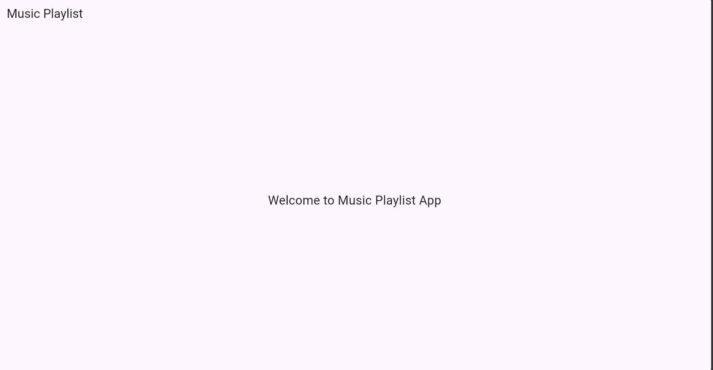
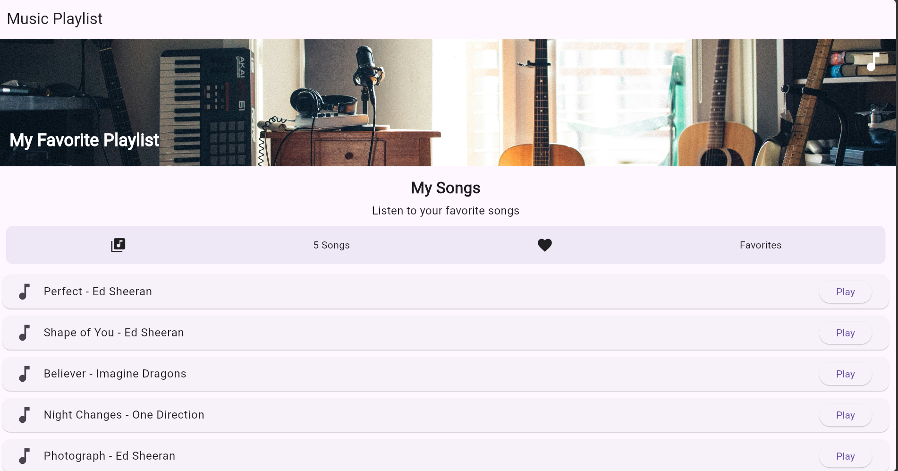
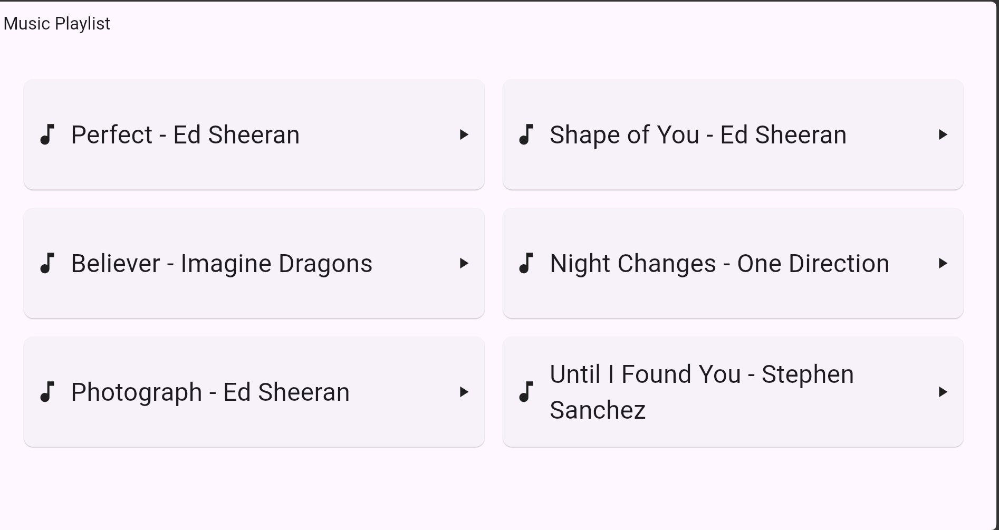
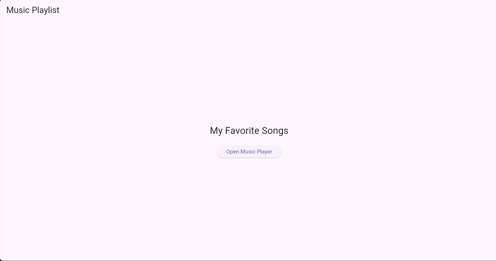
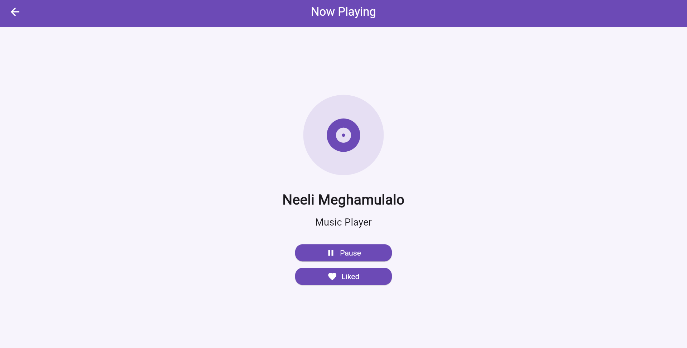
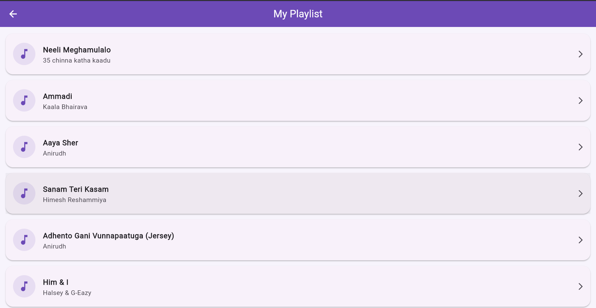
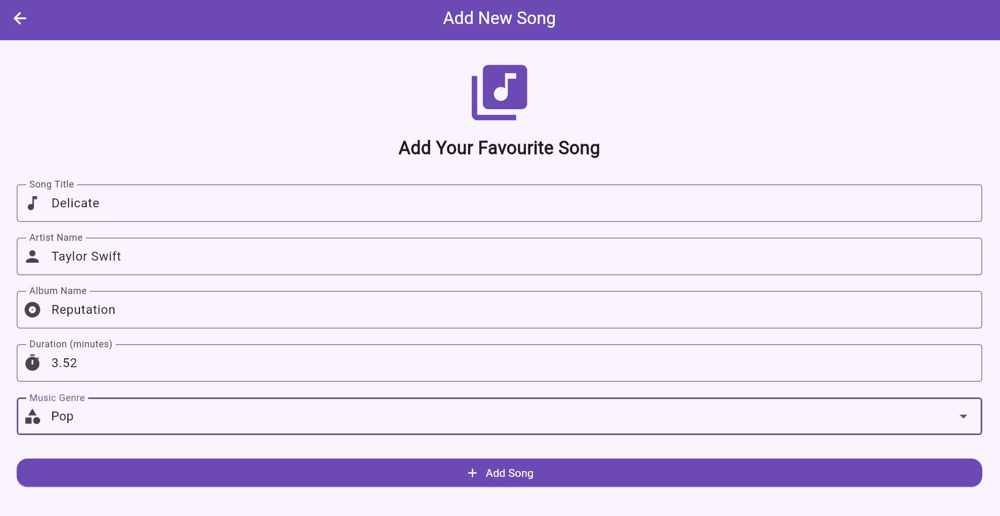
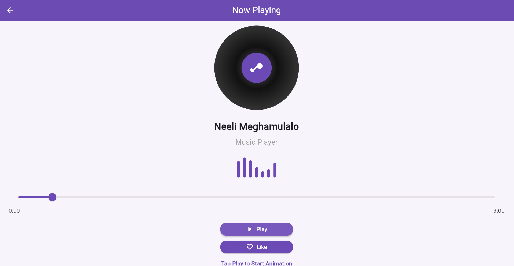
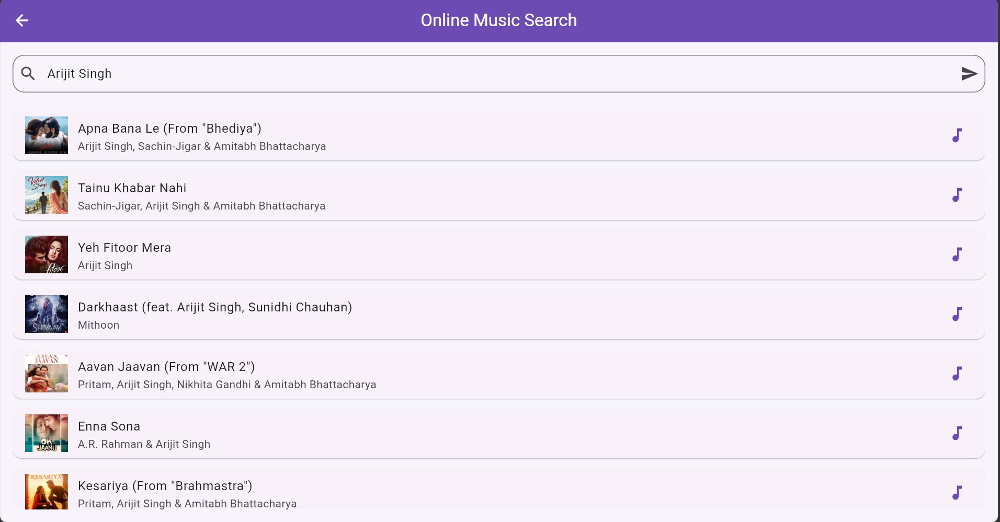
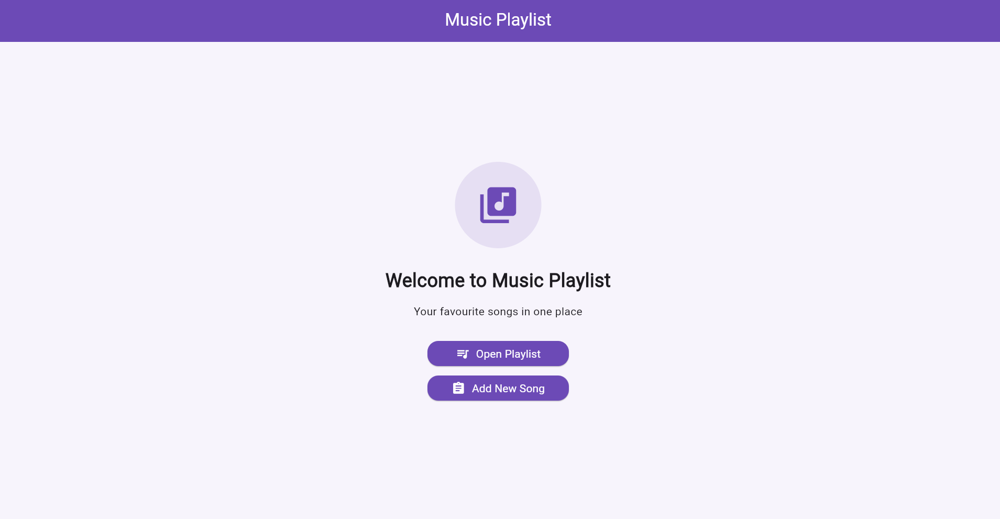

🎵 Music Playlist App – Flutter Lab Experiments

A Flutter-based Music Playlist App developed as part of college laboratory experiments. This project demonstrates Flutter fundamentals, UI design, navigation, responsive layouts, state management, forms, animations, API integration, testing, and debugging.

🛠️ Technologies Used

- Flutter
- Dart
- Provider
- HTTP package
- Visual Studio Code
- Git and GitHub

🧪 Experiments

Experiment 1: Introduction to Flutter and Dart

Description:
Introduced Flutter and Dart programming. Learned Flutter project structure, basic Dart syntax, variables, data types, and how to run a Flutter application.

Important Syntax:

void main() {
  runApp(const MyApp());
}

flutter create project1
flutter run

Output :

---

Experiment 2: Basic Flutter Widgets

Description:
Explored basic Flutter widgets such as Text, Container, Row, Column, Stack, and Image. Used these widgets to design the Music Playlist App interface.

Important Syntax:

Text("Music Playlist");

Container(
  padding: const EdgeInsets.all(16),
  child: const Text("Welcome"),
);

Row(
  children: const [
    Icon(Icons.music_note),
    Text("Music"),
  ],
);

Output :

---

Experiment 3: Responsive UI Design

Description:
Designed a responsive interface that adjusts to different screen sizes. Used MediaQuery, LayoutBuilder, and GridView to arrange widgets based on available screen space.

Important Syntax:

final width = MediaQuery.of(context).size.width;

LayoutBuilder(
  builder: (context, constraints) {
    return Text("Responsive UI");
  },
);

Output :

---

Experiment 4: Navigation Between Screens

Description:
Implemented navigation between different screens using Navigator and named routes. Practiced moving between screens and returning to the previous screen.

Important Syntax:

Navigator.push(
  context,
  MaterialPageRoute(
    builder: (context) => const SecondScreen(),
  ),
);

Navigator.pop(context);

MaterialApp(
  routes: {
    '/home': (context) => const HomeScreen(),
  },
);

Output :

---

Experiment 5: State Management Using setState() and Provider

Description:
Learned StatefulWidget and StatelessWidget. Implemented state updates using setState() and Provider with ChangeNotifier and Consumer to manage music player information and interactions.

Important Syntax:

setState(() {
  isPlaying = !isPlaying;
});

class MusicProvider extends ChangeNotifier {
  bool isPlaying = false;

  void togglePlayPause() {
    isPlaying = !isPlaying;
    notifyListeners();
  }
}

Consumer<MusicProvider>(
  builder: (context, provider, child) {
    return Text(provider.isPlaying ? "Playing" : "Paused");
  },
);

Output :

---

Experiment 6: Custom Widgets and Themes

Description:
Created reusable custom widgets to maintain a consistent interface. Used Flutter ThemeData to customize application colors, text styles, and overall appearance.

Syntax:

ThemeData(
  primaryColor: const Color(0xFF6C4AB6),
  scaffoldBackgroundColor: const Color(0xFFF7F4FC),
);

class CustomButton extends StatelessWidget {
  const CustomButton({super.key});

  @override
  Widget build(BuildContext context) {
    return ElevatedButton(
      onPressed: () {},
      child: const Text("Play"),
    );
  }
}

Output :

---

Experiment 7: User Form and Validation

Description:
Created a User Form with username, email, and password fields. Implemented form validation to check user input and display appropriate error messages.

 Syntax:

final _formKey = GlobalKey<FormState>();

TextFormField(
  validator: (value) {
    if (value == null || value.isEmpty) {
      return "Please enter your details";
    }
    return null;
  },
);

if (_formKey.currentState!.validate()) {
}

Output :

---

Experiment 8: Music Player Animations

Description:
Implemented animations to improve the music player interface. Learned AnimationController and AnimatedBuilder to create and control animation effects.

Output :

---

Experiment 9: REST API Integration

Description:
Learned how to connect a Flutter application to a REST API. Used the HTTP package to send GET requests, receive server responses, and decode JSON data.

Output :

---

Experiment 10: Testing and Debugging

Description:
Practiced testing and debugging Flutter applications. Used Flutter commands to identify errors and verify application functionality. Learned basic widget testing using flutter_test.

 Syntax:

flutter analyze
flutter test
flutter run

testWidgets('App displays title', (tester) async {
  await tester.pumpWidget(const MyApp());

  expect(find.text('Music Playlist'), findsOneWidget);
});

Output :

---

▶️ How to Run the Project

1. Clone the repository:

git clone https://github.com/Nageswari-1/project1.git

2. Open the project folder:

cd project1

3. Get dependencies:

flutter pub get

4. Run the application:

flutter run

📚 Learning Outcomes

- Understanding Flutter and Dart fundamentals.
- Designing user interfaces using Flutter widgets.
- Creating responsive layouts.
- Implementing screen navigation.
- Managing application state.
- Creating reusable widgets and themes.
- Building forms with validation.
- Implementing animations.
- Integrating REST APIs.
- Testing and debugging Flutter applications.

👩‍💻 Author

Chepuri Durga Venkata Nageswari

B.Tech – Computer Science and Engineering

📄 License

This project is developed for educational and academic purposes.